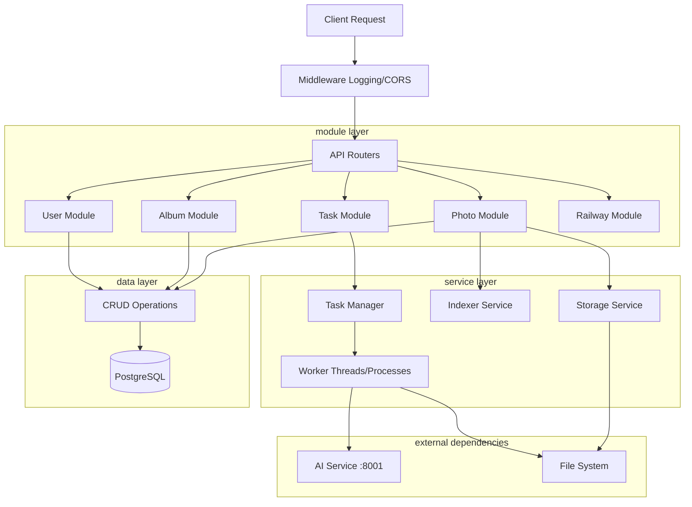
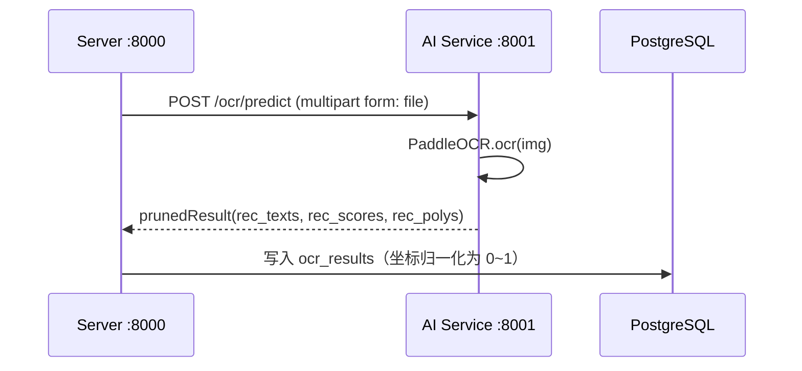

# 后端框架分析文档

## 1. 技术栈详细说明

### 1.1 核心框架
- **FastAPI**（Server）: 高性能异步 Web 框架，提供自动化 OpenAPI 文档 (`/docs`)。
- **Uvicorn**: ASGI 服务器，运行 FastAPI 应用。
- **Pydantic**: 请求/响应模型与数据校验。

### 1.2 数据持久化
- **PostgreSQL**: 主数据库。
- **SQLAlchemy (Async)**: ORM 框架，使用异步模式 (`AsyncSession`) 与数据库交互，提高并发处理能力。
- **Alembic**: 数据库版本控制工具，用于处理 Schema 变更迁移。

### 1.3 异步任务与服务
- **APScheduler**: 用于定时任务调度（虽然代码中主要使用了自定义的 TaskManager，但依赖列表中包含此库，可能用于周期性任务）。
- **TaskManager**: 自定义任务管理器 (`app/service/task_manager.py`)，用于处理耗时操作，如：
  - 照片扫描与索引
  - 缩略图生成
  - 元数据提取
  - OCR 识别任务

### 1.4 AI 与 图像处理
- **PaddleOCR**（AI 微服务）: 文本检测与识别，支持 `rec_texts/rec_scores/rec_polys` 输出。
- **InsightFace**（AI 微服务）: 人脸检测/关键点/特征提取。
- **YOLO (Ultralytics)**: 服务端独立脚本用于票据区域检测与裁剪。
- **OpenCV**: 图像解码与基础处理。

## 2. 服务模块划分与调用关系

### 2.2 AI 微服务调用链

### 2.1 关键模块解析
- **API Routers (`app/api`)**: 控制层，处理 HTTP 请求，参数校验，调用 Service 或 CRUD 层。
- **CRUD Layer (`app/crud`)**: 数据访问层，封装所有数据库交互逻辑，保持业务逻辑纯净。
- **Service Layer (`app/service`)**: 业务逻辑层，处理复杂业务，如文件系统操作、调用 AI 模型、后台任务管理。

## 3. API 设计规范与现状

### 3.1 规范
- **RESTful 风格**: 接口设计遵循资源导向，如 `GET /albums` 获取列表，`POST /albums` 创建相册。
- **响应格式**: 使用 Pydantic 模型定义 Response Schema，确保返回数据结构一致。
- **状态码**: 遵循 HTTP 标准状态码（200 成功, 201 创建, 400 请求错误, 401 未授权, 404 未找到, 500 服务器错误）。

### 3.2 接口文档现状
- **Swagger UI**: FastAPI 自动生成交互式文档，地址通常为 `/docs`。
- **ReDoc**: 另一种风格的文档，地址通常为 `/redoc`。
- **主要资源**:
  - `/users`: 用户相关。
  - `/albums`: 相册的增删改查。
  - `/photos`: 照片上传、流式获取、元数据管理。
  - `/tasks`: 任务状态查询、任务触发。
  - `/settings`: 系统配置管理。
  - `/faces`: 人脸实体与照片管理。
  - `/ocr`: OCR 识别记录查询（`GET /ocr?photo_id=...`）。
  - `/train-ticket`: 火车票 CRUD 与导出。
  - `/railway`: 铁路站点与运行计划接口。

### 3.3 日志与异常
- **日志**: JSON 队列日志 + 按日容量滚动；每条记录包含 `timestamp/level/message/operation/params/result`。
- **异常**: 统一捕获并写入日志；AI 调用失败或图像解码错误将返回相应错误码并记录。

### 3.4 数据模型说明（示例）
- **OCR 结果**（表 `ocr_results`）：
  - `text: str`、`text_score: float`、`polygon: List[List[float]]`（坐标归一化至 0~1）
  - 查询接口：`GET /ocr?photo_id=<uuid>` 返回列表记录
